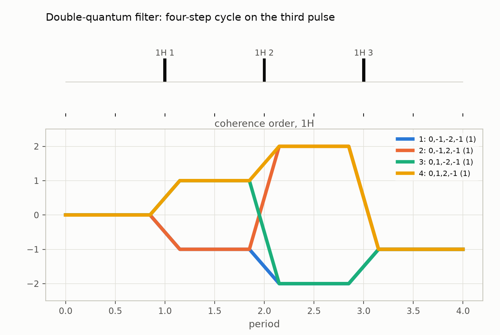
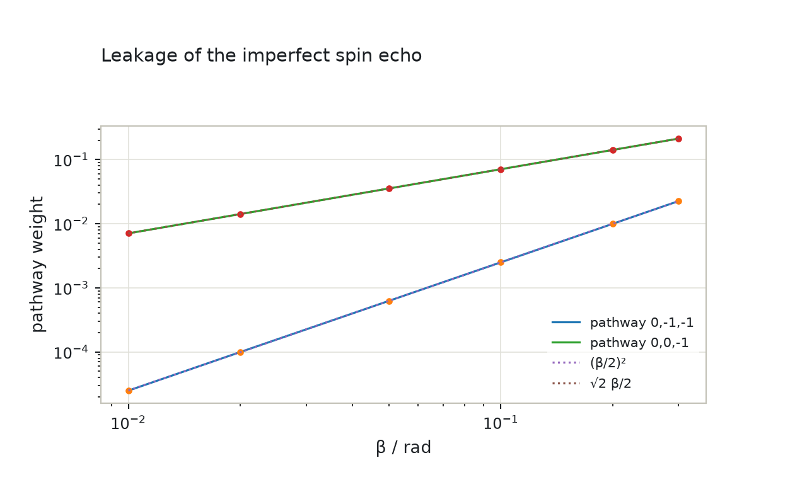
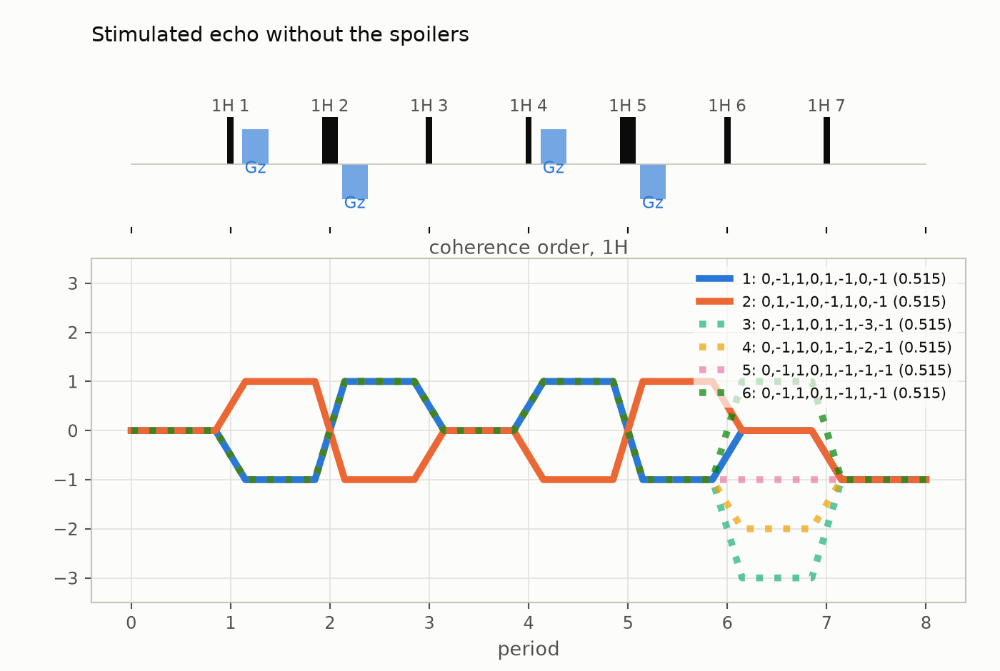
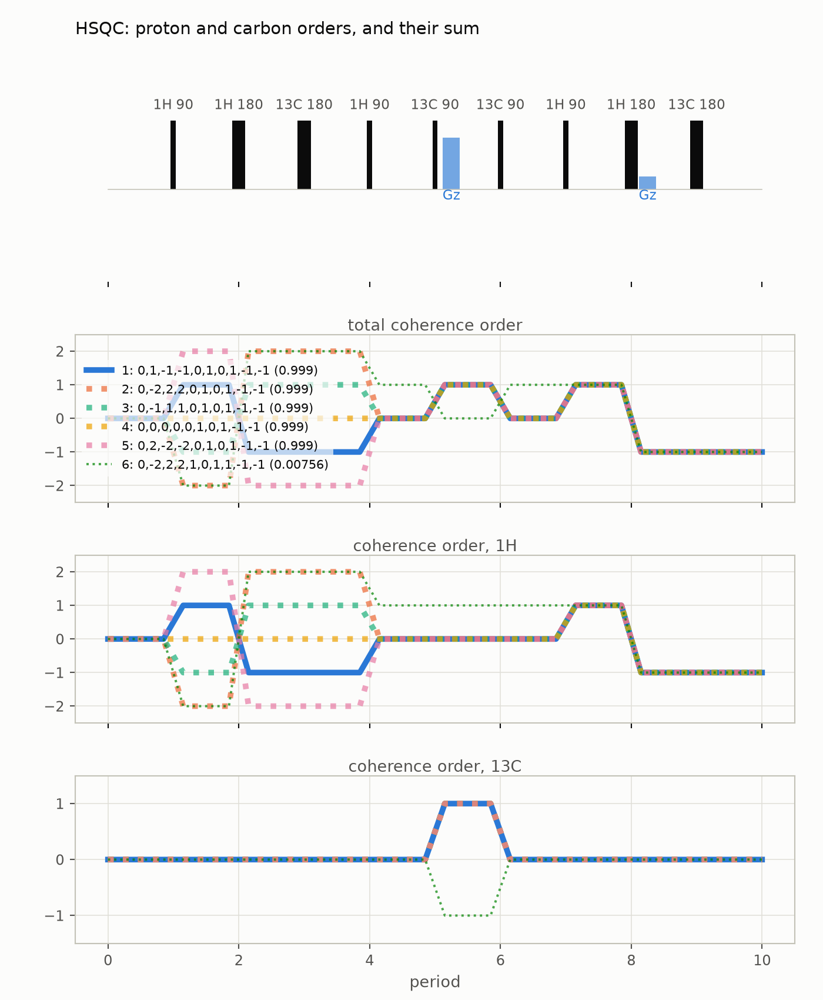
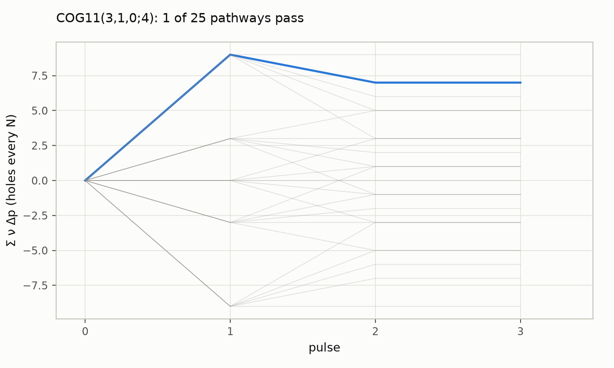

# Coherence transfer pathways: worked examples

A cookbook for the `ctps` module, in two parts: ten worked cases, from a
double-quantum filter to crusher optimisation, and then the checks behind the
module's tests, repeated as runnable examples so that the evidence is on the
page. [Coherence transfer pathways](ctps.md) explains the module and its
conventions; this guide assumes it. The companion notebook is
[`notebooks/ctps-examples.ipynb`](notebooks/ctps-examples.ipynb) ([interactive figures on nbviewer](https://nbviewer.org/github/ajerschow/spynach/blob/main/docs/notebooks/ctps-examples.ipynb)).

## Contents

Worked cases

1. [A double-quantum filter](#a-double-quantum-filter)
2. [Spin echo: leakage versus flip-angle error](#spin-echo-leakage-versus-flip-angle-error)
3. [Stimulated echo: echo and anti-echo](#stimulated-echo-echo-and-anti-echo)
4. [A NOESY-sized enumeration: 352,947 pathways](#a-noesy-sized-enumeration-352947-pathways)
5. [HSQC with two nuclei](#hsqc-with-two-nuclei)
6. [MQMAS: nested versus cogwheel](#mqmas-nested-versus-cogwheel)
7. [5Q3QMAS and the HCL construction](#5q3qmas-and-the-hcl-construction)
8. [Multi-echo trains: 2n + 1 steps](#multi-echo-trains-2n--1-steps)
9. [Cogwheel plus gradients](#cogwheel-plus-gradients)
10. [MRS crushers and fixed-length cycles](#mrs-crushers-and-fixed-length-cycles)

The checks behind the tests

11. [The 1998 table, row by row](#the-1998-table-row-by-row)
12. [Every published cogwheel cycle](#every-published-cogwheel-cycle)
13. [The 22 solutions at N = 23](#the-22-solutions-at-n--23)
14. [The N_opt grid of Hughes 2004](#the-n_opt-grid-of-hughes-2004)
15. [The pulse model against exact rotations](#the-pulse-model-against-exact-rotations)
16. [Engine self-consistency](#engine-self-consistency)
17. [The optimiser against the MRS papers](#the-optimiser-against-the-mrs-papers)
18. [Running the tests and rebuilding this notebook](#running-the-tests-and-rebuilding-this-notebook)

```python
import itertools
import json
import time
from pathlib import Path

import numpy as np

from ctps import AllowedOrders, Nucleus, Period, PhaseCycle, Pulse, Sample, Sequence, simulate
from ctps import coverage, find_cycle, hcl_cycle

ms = 1e-3
H = Nucleus("1H")
```

## A double-quantum filter

Three 90° pulses; the third one converts double-quantum coherence (`p = ±2`)
into observable `−1`, a jump `Δp₃ = −3` or `+1`. The four-step cycle
`φ₃ = 0, 90, 180, 270` with receiver `0, 270, 180, 90` keeps `Δp₃ ≡ 1 (mod 4)`
and rejects the single-quantum pathways (`Δp₃ = −1` or `0`, through `p₂ = 0`
or `±1`). The first pulse acts on `z` magnetisation, so period 1 is limited
to `±1`. `simulate` enumerates every pathway the allowed orders permit,
weights it and ranks it; `table()` lists the factors; `leakage()` counts the
unwanted pathways above a fraction of the strongest wanted one:

```python
dqf = Sequence.simple(n_pulses=3, p_max=2, periods={1: [-1, 1]})
four = PhaseCycle.explicit([[0], [0], [0, 1, 2, 3]], receiver=[0, 3, 2, 1], base=4)
wanted_dqf = [(0, 1, 2, -1), (0, -1, 2, -1), (0, 1, -2, -1), (0, -1, -2, -1)]
dq = simulate(dqf, four, wanted=wanted_dqf)
print(f"{dq.n_enumerated} pathways, {len(dq)} with a nonzero phase-cycle factor, {dq.leakage(0.01)} unwanted above 1%")
for row in dq.table():
    print(row["pathway"], "wanted" if row["wanted"] else "      ", f"pc {row['pc']:.2f}")
```

```python
from ctps.plot import plot_pathways

plot_pathways(dq, top=8, title="Double-quantum filter: four-step cycle on the third pulse")
```



A two-step cycle on the same pulse, `φ₃ = 0, 180` with receiver `0, 180`,
only keeps `Δp₃` odd, so the pathways through `p₂ = 0` survive too:

```python
two = PhaseCycle.explicit([[0], [0], [0, 2]], receiver=[0, 2], base=4)
dq2 = simulate(dqf, two, wanted=wanted_dqf)
print(f"two steps: {len(dq2)} pathways pass, {dq2.leakage(0.01)} unwanted above 1%")
print(sorted({tuple(int(v) for v in p) for p in dq2.orders[~dq2.wanted]}))
```

## Spin echo: leakage versus flip-angle error

The Hahn echo of the 2000 paper: a 90° pulse and a 180° pulse `β` short of π.
The inverted pathway `0, 1, −1` passes with weight 1; the non-inverted
`0, −1, −1` leaks with weight `(β/2)²` and the pathway through `z`,
`0, 0, −1`, with `√2 β/2`, as the leading terms of the rotation matrix
elements give. Scanning `β` with `simulate` shows the quadratic and linear
scalings:

```python
betas = np.array([0.01, 0.02, 0.05, 0.1, 0.2, 0.3])
leak = {(0, -1, -1): [], (0, 0, -1): []}
for beta in betas:
    echo = Sequence(
        nuclei=(H,),
        pulses=(Pulse("1H"), Pulse("1H", "imperfect_180", beta=beta)),
        periods=(Period(), Period(), Period()),
        allowed={"1H": AllowedOrders.standard(1, 3)},
    )
    one_step = PhaseCycle.explicit([[0], [0]], receiver=[0])
    result = simulate(echo, one_step, epsilon=0, cutoff=0)
    rows = {tuple(int(v) for v in r): float(result.amplitude[i]) for i, r in enumerate(result.orders)}
    for path in leak:
        leak[path].append(rows[path])
for path, values in leak.items():
    print(path, " ".join(f"{v:.2e}" for v in values))
print("ratio of successive values at beta 0.1 and 0.2:", {p: round(v[4] / v[3], 2) for p, v in leak.items()})
```

```python
import plotly.graph_objects as go

fig = go.Figure()
for path, values in leak.items():
    fig.add_scatter(x=betas, y=values, mode="lines+markers", name=f"pathway {','.join(map(str, path))}")
fig.add_scatter(x=betas, y=(betas / 2) ** 2, mode="lines", line={"dash": "dot"}, name="(β/2)²")
fig.add_scatter(x=betas, y=np.sqrt(2) * betas / 2, mode="lines", line={"dash": "dot"}, name="√2 β/2")
fig.update_layout(title="Leakage of the imperfect spin echo", xaxis_title="β / rad", yaxis_title="pathway weight",
                  xaxis_type="log", yaxis_type="log", width=640, height=400)
fig
```



## Stimulated echo: what the spoilers do

The 1998 Fig. 4 sequence (built here as in the `ctps` guide, pulses 2 and 5
as perfect 180° pulses) stores magnetisation along `z` during the long mixing
period 3 and refocuses the pathway pair `0, ∓1, ±1, 0, ±1, ∓1, 0, −1` with its
bipolar gradient pairs. The transverse spoilers in periods 3 and 6 are there
for the pathways that carry coherence through those periods; comparing the
sequence with and without them shows what they remove:

```python
def stimulated_echo(spoilers: bool = True) -> Sequence:
    periods = [
        Period(),
        Period.with_gradient(2 * ms, "z", 0.25, 1 * ms),
        Period.with_gradient(2 * ms, "z", -0.25, 1 * ms),
        Period.with_gradient(50 * ms, "x", 0.025, 1 * ms) if spoilers else Period(50 * ms),
        Period.with_gradient(2 * ms, "z", 0.25, 1 * ms),
        Period.with_gradient(2 * ms, "z", -0.25, 1 * ms),
        Period.with_gradient(0.0, "y", 0.025, 1 * ms) if spoilers else Period(),
        Period(),
    ]
    allowed = AllowedOrders.standard(3, 8).only(1, [-1, 0, 1])
    pulses = tuple(Pulse("1H", "perfect_180" if j in (1, 4) else "free") for j in range(7))
    return Sequence((H,), pulses, tuple(periods), {"1H": allowed}, Sample(5 * ms, 2.5 * ms), diffusion=7e-10)


ste_cycle = PhaseCycle.explicit(
    [[0, 0, 1, 1, 2, 2, 3, 3], [1, 2, 2, 3, 3, 0, 0, 1], [0], [2, 2, 3, 3], [3, 3, 0, 0], [2], [0]],
    receiver=[0, 2, 0, 2, 2, 0, 2, 0],
    base=4,
)
wanted_ste = [(0, -1, 1, 0, 1, -1, 0, -1), (0, 1, -1, 0, -1, 1, 0, -1)]
for spoilers in (False, True):
    result = simulate(stimulated_echo(spoilers), ste_cycle, wanted=wanted_ste)
    print(f"spoilers {spoilers!s:5}: {len(result)} pathways above threshold, {result.leakage(0.01)} unwanted above 1%, "
          f"strongest unwanted {result.amplitude[~result.wanted][0]:.3f}: {result.orders[~result.wanted][0].tolist()}")
```

```python
plot_pathways(simulate(stimulated_echo(False), ste_cycle, wanted=wanted_ste), top=6, title="Stimulated echo without the spoilers")
```



## A NOESY-sized enumeration: 352,947 pathways

Eight pulses, orders up to ±3 after the first period, as in the 1998
2Q-NOESY example: `3 · 7⁶ = 352,947` pathways, with the gradient scheme and
delays of that figure and an eight-step cycle on the first and last pulses.
The enumeration and the weighting are vectorised over chunks of pathways and
`workers=` spreads the chunks over processes; the point here is scale and
speed:

```python
delays = [15, 15, 15, 15, 7.5, 1.35, 1.35, 1.35]
gradients = {1: ("x", 0.05), 2: ("z", 0.05), 3: ("z", -0.05), 4: ("z", 0.2)}
periods = [Period()]
for i in range(1, 9):
    if i in gradients:
        periods.append(Period.with_gradient(delays[i - 1] * ms, *gradients[i], 1.25 * ms))
    else:
        periods.append(Period(delays[i - 1] * ms))
noesy = Sequence(
    (H,),
    tuple(Pulse("1H") for _ in range(8)),
    tuple(periods),
    {"1H": AllowedOrders.standard(3, 9).only(1, [-1, 0, 1])},
    Sample(5 * ms, 2.5 * ms),
    diffusion=2e-9,
)
noesy_cycle = PhaseCycle.explicit(
    [[0, 0, 0, 0, 2, 2, 2, 2], [0], [0], [0], [0], [0], [0], [0, 3, 2, 1]], receiver=[0, 2, 0, 2, 2, 0, 2, 0], base=4
)
for workers in (1, 2):
    start = time.perf_counter()
    result = simulate(noesy, noesy_cycle, cutoff=1e-4, workers=workers)
    print(f"{result.n_enumerated} pathways, {len(result)} above 1e-4, {time.perf_counter() - start:.2f} s with {workers} worker(s)")
print("strongest:", [tuple(int(v) for v in o) for o in result.orders[:2]], [round(float(a), 4) for a in result.amplitude[:2]])
```

## HSQC with two nuclei

The nine-pulse HSQC of the 1998 Fig. 9, with proton orders up to ±2, carbon
±1, perfect 180° pulses, the four-step cycle on the two carbon 90° pulses
(`x, −x` and `x, x, −x, −x`, receiver `x, −x, −x, x`) and a gradient pair,
0.199 T/m on carbon coherence during the evolution and 0.05 T/m on proton
coherence before detection, in the ratio of the gyromagnetic ratios so that
one member of the echo/anti-echo pair refocuses. Each nucleus keeps its own
order; the explorer shows both and their sum:

```python
C = Nucleus("13C")
kinds = ["90", "180", "180", "90", "90", "90", "90", "180", "180"]
on = ["1H", "1H", "13C", "1H", "13C", "13C", "1H", "1H", "13C"]
periods = [Period() for _ in range(10)]
periods[5] = Period.with_gradient(1.85 * ms, "z", 0.199, 1 * ms)  # during the evolution, on carbon coherence
periods[8] = Period.with_gradient(1.85 * ms, "z", 0.05, 1 * ms)  # before detection, on proton coherence
hsqc = Sequence(
    (H, C),
    tuple(Pulse(n, "perfect_180" if k == "180" else "free", label=f"{n} {k}") for n, k in zip(on, kinds)),
    tuple(periods),
    {"1H": AllowedOrders.standard(2, 10), "13C": AllowedOrders.standard(1, 10, end=[0])},
    Sample(5 * ms, 2.5 * ms),
)
hsqc_cycle = PhaseCycle.explicit([[0]] * 4 + [[0, 2], [0, 0, 2, 2], [0], [0], [0]], receiver=[0, 2, 2, 0], base=4)
hsqc_wanted = [(0, 1, -1, -1, 0, 1, 0, 1, -1, -1), (0, 1, -1, -1, 0, -1, 0, 1, -1, -1)]
hsqc_result = simulate(hsqc, hsqc_cycle, wanted=hsqc_wanted)
print(f"{hsqc_result.n_enumerated} pathways, {len(hsqc_result)} above threshold, {hsqc_result.leakage(0.05)} unwanted above 5%")
for row in hsqc_result.table()[:4]:
    print(row["pathway"], "wanted" if row["wanted"] else "      ", f"total {row['total']:.3f}  grad {row['grad']:.3f}")
```

```python
plot_pathways(hsqc_result, top=6, title="HSQC: proton and carbon orders, and their sum")
```



## MQMAS: nested versus cogwheel

Triple-quantum MAS on a spin 3/2 selects `0, +3, +1, −1`. The nested cycle
needs 7 × 5 = 35 steps; `PhaseCycle.nested` builds it from the per-pulse
lists (pulse 0 stepping fastest), and the receiver list is written out.
Levitt's `COG23(0,3,4;14)` does the same in 23. The 2003 paper's variants
shorten the cycle further by restricting the orders: with odd orders only
and a perfect detector, 11 steps suffice; with the detector also accepting
`0` and `+1`, 29 (all orders) or 19 (odd orders). `simulate` verifies each:
every unwanted pathway must have `pc = 0`:

```python
mqmas = Sequence.simple(3, 3)
# the nested cycle: 7 steps on pulse 1 (selecting Δp = +3) nested with 5 on pulse 3 (Δp = -2), on the common base 35
levels = PhaseCycle.nested([[5 * k for k in range(7)], [0], [7 * k for k in range(5)]], receiver=[0], base=35)
rec = [(-3 * levels.phases[0][m] + 2 * levels.phases[2][m]) % 35 for m in range(35)]  # φ_rec = -Σ Δp_j φ_j for the wanted pathway
nested35 = PhaseCycle.explicit(levels.phases, receiver=rec, base=35)


def verify(sequence, cycle, wanted):
    result = simulate(sequence, cycle, wanted=wanted, epsilon=0, cutoff=0)
    unwanted = np.abs(result.pc[~result.wanted])
    print(f"{cycle.cog_string():>40}: {cycle.steps:3d} steps, {result.wanted.sum()} wanted at |pc| = 1, "
          f"largest unwanted |pc| = {unwanted.max() if unwanted.size else 0:.1e}")


verify(mqmas, nested35, [(0, 3, 1, -1)])
verify(mqmas, PhaseCycle.cogwheel(23, [0, 3, 4], 14), [(0, 3, 1, -1)])
verify(Sequence.simple(3, 3, orders=[-3, -1, 0, 1, 3]), PhaseCycle.cogwheel(11, [3, 1, 0], 4), [(0, 3, 1, -1)])
verify(Sequence.simple(3, 3, end=[-1, 0, 1]), PhaseCycle.cogwheel(29, [9, 11, 2], 28), [(0, 3, 1, -1)])
verify(Sequence.simple(3, 3, end=[-1, 0, 1], orders=[-3, -1, 0, 1, 3]), PhaseCycle.cogwheel(19, [3, 8, 1], 9), [(0, 3, 1, -1)])
```

```python
from ctps.plot import plot_selection_diagram

plot_selection_diagram(PhaseCycle.cogwheel(11, [3, 1, 0], 4), Sequence.simple(3, 3, orders=[-3, -1, 0, 1, 3]), wanted=[(0, 3, 1, -1)])
```



## 5Q3QMAS and the HCL construction

For `0, +5, +3, +1, −1` on a spin 5/2 the Hughes–Carravetta–Levitt formula
gives 201 steps (nested: 693). Restricting the orders shortens it, as the 2003
paper shows: odd orders only give `COG55`, and fixing the last two orders at
`+1, −1` gives `COG29`. Verification by `simulate` is instant where a search
up to 201 would take a while:

```python
print("HCL:", hcl_cycle([5, 3, 1], [5, 5, 5]).cog_string())
verify(Sequence.simple(4, 5), PhaseCycle.cogwheel(201, [157, 142, 3, 0], 108), [(0, 5, 3, 1, -1)])
verify(Sequence.simple(4, 5, orders=[-5, -3, -1, 0, 1, 3, 5]), PhaseCycle.cogwheel(55, [33, 30, 1, 0], 7), [(0, 5, 3, 1, -1)])
verify(Sequence.simple(4, 5, orders=[-5, -3, -1, 0, 1, 3, 5], periods={3: [1], 4: [-1]}), PhaseCycle.cogwheel(29, [3, 1, 0, 0], 16), [(0, 5, 3, 1, -1)])
```

## Multi-echo trains: 2n + 1 steps

A preparation pulse followed by `n` refocusing pulses, orders `0, ±1`, wanted
pathway alternating `+1, −1`: nested cycling needs `5^(n/2)` steps (`n` even),
a cogwheel cycle `2n + 1` with winding numbers alternating 0 and 1 (Levitt
2002). `find_cycle` finds them:

```python
for n in (3, 5):
    train = Sequence.simple(n + 1, 1)
    wanted = [tuple([0] + [(-1) ** k for k in range(n + 1)])]
    found = find_cycle(train, wanted)
    print(f"{n} refocusing pulses: {found.best.cog_string()}, nested would need {5 ** ((n + 1) // 2)} steps")
```

## Cogwheel plus gradients

The one-spin PFG stimulated echo of the 2003 paper (orders fixed at 0 after
pulses 3 and 6) has the cogwheel cycle `COG8(0,7,0,0,1,0,0;4)`. With the
bipolar gradients of the 1998 example in place, most unwanted pathways are
already attenuated, so the cycle only has to reject the rest:
`pathway_weights` returns every pathway's gradient × diffusion × pulse
weight in enumeration order, and `find_cycle(..., weights=g, tolerance=...)`
accepts a cycle once the summed weight of the surviving unwanted pathways is
below the tolerance:

```python
from ctps.optimize import pathway_weights

pfg = Sequence.simple(7, 1, periods={3: [0], 6: [0]})
wanted_pfg = [(0, -1, 1, 0, 1, -1, 0, -1), (0, 1, -1, 0, -1, 1, 0, -1)]
print("phase cycling alone:", find_cycle(pfg, wanted_pfg).best.cog_string())
with_gradients = Sequence(
    pfg.nuclei, pfg.pulses, stimulated_echo().periods[:3] + stimulated_echo().periods[3:], pfg.allowed, Sample(5 * ms, 2.5 * ms)
)
orders, g = pathway_weights(with_gradients)
print(f"{len(orders)} pathways; {int((g < 1e-3).sum())} already below 1e-3 from the gradients")
weighted = find_cycle(with_gradients, wanted_pfg, weights=g, tolerance=0.05)
print(f"with the gradients taken into account: {weighted.best.cog_string()}, surviving weight {weighted.best.residual:.3f}")
```

## MRS crushers and fixed-length cycles

PRESS and sLASER from the DOTCOPS papers: `crusher_scheme` maximises the
smallest and the mean dephasing of the unwanted pathways (the k-space radius
`|Σ p_i X_i|`, with the wanted pathway refocused and per-crusher bounds), and
`coverage` finds, for a fixed number of steps, the cogwheel cycle that cancels
the most unwanted pathways. The chosen cycle goes to the spectrometer through
`bruker_phase_program` or a `phase_table`, and the pathway list to a file:

```python
from ctps.io import bruker_phase_program, phase_table, write_csv
from ctps.optimize import crusher_scheme

press = Sequence.simple(3, 1)
bounds = np.array([[0, 0, 0], [1, 1, 1], [2, 2, 2], [1, 1, 1]], dtype=float)
scheme = crusher_scheme(press, [(0, -1, 1, -1)], bounds=bounds, starts=40)
print(f"PRESS crushers: min D = {scheme['min_D']:.3f}, mean D = {scheme['mean_D']:.3f}")
print(np.round(scheme["areas"], 2))
slaser = Sequence.simple(5, 1)
for N in (8, 16):
    best = coverage(slaser, [(0, -1, 1, -1, 1, -1)], N).best
    print(f"sLASER, {N} steps: {best.cog_string()}, {best.survivors} unwanted pathways survive")
print(bruker_phase_program(best.cycle))
print(phase_table(best.cycle)[1])
chosen = simulate(slaser, best.cycle, wanted=[(0, -1, 1, -1, 1, -1)])
write_csv(chosen, Path("slaser_pathways.csv"))
print(Path("slaser_pathways.csv").read_text().splitlines()[:2])
Path("slaser_pathways.csv").unlink()
```

## The 1998 table, row by row

The module's tests live in `tests/ctps/`; the rest of this guide repeats
their checks as examples. The fixture files under
`tests/ctps/fixtures/papers/` hold the published numbers; the repository
root is found by walking up from the working directory, so the same block
runs in the test suite (from the root) and in the notebook (from
`docs/notebooks/`). The first check is the Fig. 4 table of the 1998 paper:
pathway count, phase-cycle factor and its phase, gradient and diffusion
factors, compared row by row (`pytest tests/ctps -k ste_1998`):

```python
root = next(p for p in [Path.cwd(), *Path.cwd().parents] if (p / "pyproject.toml").exists())
fixtures = root / "tests" / "ctps" / "fixtures" / "papers"
fx = json.loads((fixtures / "ste_1998_fig4.json").read_text())

periods = [Period()]
for i in range(1, fx["n_pulses"] + 1):
    duration = fx["durations_s"].get(str(i), 0.0)
    if str(i) in fx["gradients"]:
        axis, amplitude = fx["gradients"][str(i)]
        periods.append(Period.with_gradient(duration, axis, amplitude, fx["gradient_length_s"]))
    else:
        periods.append(Period(duration))
paper = Sequence(
    (Nucleus("1H", gamma=fx["gamma"]),),
    tuple(Pulse("1H") for _ in range(fx["n_pulses"])),
    tuple(periods),
    {"1H": AllowedOrders.standard(fx["p_max"], fx["n_pulses"] + 1).only(1, fx["allowed_period_1"])},
    Sample(**fx["sample"]),
    diffusion=fx["diffusion"],
)
paper_cycle = PhaseCycle.explicit(fx["cycle"]["phases"], fx["cycle"]["receiver"], fx["cycle"]["base"])
check = simulate(paper, paper_cycle, epsilon=1e-9, cutoff=0)
print(f"pathways: {check.n_enumerated} computed, {fx['n_pathways']} in the paper")
index = {tuple(int(v) for v in r): i for i, r in enumerate(check.orders)}
print("pathway                   pc (paper)  phase (paper)   grad (paper)      diff (paper)")
for row in fx["rows"]:
    i = index[tuple(row["pathway"])]
    phase = np.degrees(np.angle(check.pc[i])) % 360
    note = "" if row["pathway"] in fx["wanted"] else "   diff needs the delay after the last gradient (CCCP.m source)"
    print(f"{','.join(f'{p:+d}' for p in row['pathway'])}  {abs(check.pc[i]):.4f} ({row['pc']})  {phase:5.0f} ({row['pc_phase_deg']})"
          f"   {check.grad[i]:.4f} ({row['grad']})   {check.diff[i]:.4f} ({row['diff']}){note}")
```

## Every published cogwheel cycle

`cogwheel_cycles.json` lists every cycle stated in Levitt 2002, Hughes 2004
and Jerschow & Kumar 2003 with its allowed orders and wanted pathways.
`cogwheel_selects` applies the selection rule `Σ ν_j Δp_j + ν_rec ≡ 0 (mod N)`
to the jumps of every enumerated pathway; the selected set must equal the
stated one (`pytest tests/ctps/test_cogwheel.py`). One case is skipped:
the 2003 `COG80` does not select its stated pathways as printed and waits for
a check against the CCCP++ source:

```python
from ctps.engine.phase import cogwheel_selects, receiver_winding


def enumerate_case(case):
    n = len(case["nu"])
    overrides = {int(k): v for k, v in case.get("periods", {}).items()}
    sets = [list(case["p0"])] + [overrides.get(i, case["orders"]) for i in range(1, n)] + [overrides.get(n, case["detect"])]
    return np.array(list(itertools.product(*sets)), dtype=np.int16)


cases = json.loads((fixtures / "cogwheel_cycles.json").read_text())["cases"]
for case in cases:
    if "skip" in case:
        print(f"skipped: {case['name']}")
        continue
    paths = enumerate_case(case)
    selected = cogwheel_selects(np.diff(paths, axis=1), case["N"], np.array(case["nu"]), case["nu_rec"])
    got = {tuple(int(v) for v in r) for r in paths[selected]}
    verdict = "selects exactly" if got == {tuple(w) for w in case["wanted"]} else "MISMATCH"
    print(f"{verdict}: {case['name']} ({len(paths)} pathways)")
```

## The 22 solutions at N = 23

Levitt 2002 states that exactly 22 winding-number pairs select the 3Q-MAS
pathway at 23 steps. `receiver_winding` computes the receiver each candidate
needs, and the brute-force loop over all pairs counts the solutions; they are
one orbit under multiplication by units modulo 23, which is why `find_cycle`
reports a single representative:

```python
case = next(c for c in cases if "COG23(0,3,4;14)" in c["name"])
paths = enumerate_case(case)
dp = np.diff(paths, axis=1)
wanted_set = {tuple(w) for w in case["wanted"]}
solutions = []
for a in range(23):
    for b in range(23):
        nu = np.array([0, a, a + b]) % 23
        rec = receiver_winding(np.diff(case["wanted"][0]), 23, nu)
        if {tuple(int(v) for v in r) for r in paths[cogwheel_selects(dp, 23, nu, rec)]} == wanted_set:
            solutions.append((a, b))
print(len(solutions), "solutions:", solutions)
```

## The N_opt grid of Hughes 2004

For two intervals with `p_max = 3`, the smallest cogwheel cycle for every
wanted pair `(p1, p2)` equals the HCL prediction except for `(2, 2)`, where
22 steps are needed against a predicted 20. Four cells of the grid, each a
full scan from `N = 2` (`pytest tests/ctps -k n_opt_grid` runs all sixteen):

```python
grid = Sequence.simple(3, 3)
for p1, p2 in ((1, 1), (2, 2), (3, 3), (0, 3)):
    found = find_cycle(grid, [(0, p1, p2, -1)], N_max=30)
    print(f"({p1}, {p2}): N_opt = {found.best.N}, HCL prediction {hcl_cycle([p1, p2], [3, 3]).N}")
```

## The pulse model against exact rotations

`f_coefficient(l, m', m)` is the coefficient of `(β/2)^|m − m'|` in the
Wigner element `d^l_{m'm}(β)` (2000 paper, Eq. 13); `wigner_d` is the exact
matrix; `transfer_matrix` builds the per-pulse weights, with `exact=True`
using the full rotation (`pytest tests/ctps/test_pulse.py`):

```python
from ctps.engine.pulse import f_coefficient, transfer_matrix, wigner_d

beta = 1e-3
worst = 0.0
for l in (1, 2, 3, 4):
    d = wigner_d(l, beta)
    for mp in range(-l, l + 1):
        for m in range(-l, l + 1):
            leading = f_coefficient(l, mp, m) * (beta / 2) ** abs(m - mp)
            worst = max(worst, abs(d[mp + l, m + l] - leading) / max(abs(leading), 1e-30))
print(f"largest relative deviation of the leading term from d^l at beta = {beta}: {worst:.1e} (second order in beta)")

leading = transfer_matrix("imperfect_180", 2, l=2, beta=2e-3, epsilon=3e-3)
exact = transfer_matrix("imperfect_180", 2, l=2, beta=2e-3, epsilon=3e-3, exact=True)
print("near-pi transfers, leading term versus exact rotation, largest relative difference:",
      f"{np.max(np.abs(leading - exact) / np.maximum(exact, 1e-30)):.1e}")

U = transfer_matrix("small_flip", 3, l=1, n_spins=3, beta=0.02)  # three spins-1/2, d = beta/2 = 0.01
at = lambda pp, p: U[pp + 3, p + 3]  # noqa: E731
print("Table IV of the 2000 paper, d = 0.01:")
print(f"  (2 -> 3): {at(3, 2):.4e}  paper sqrt(2) d = {np.sqrt(2) * 0.01:.4e}")
print(f"  (-1 -> 2 -> 3): {at(2, -1) * at(3, 2):.4e}  paper 4 d^4 = {4 * 0.01**4:.4e}")
print(f"  (-1 -> 3): {at(3, -1):.4e}  paper 2 d^4 = {2 * 0.01**4:.4e}")
```

## Engine self-consistency

Two formulations of the phase-cycle sum must agree: the integer one, which
evaluates `Σ exp(−i(Δp·φ + φ_rec))` through a table of the roots of unity on
the cycle's common base, and the direct complex sum. Chunking and worker
processes must not change the result either:

```python
from ctps.engine.phase import phase_cycle_factor

rng = np.random.default_rng(0)
dp = rng.integers(-3, 4, size=(200, 5))
phases = [rng.integers(0, 8, size=rng.integers(1, 9)).tolist() for _ in range(5)]
random_cycle = PhaseCycle.explicit(phases, rng.integers(0, 8, size=4).tolist(), base=8)
print("integer versus direct sum, largest difference:",
      f"{np.abs(phase_cycle_factor(dp, random_cycle, integer=True) - phase_cycle_factor(dp, random_cycle, integer=False)).max():.1e}")

whole = simulate(paper, paper_cycle, epsilon=1e-9, cutoff=0)
parts = simulate(paper, paper_cycle, epsilon=1e-9, cutoff=0, chunk=5000, workers=2)
key = lambda r: sorted(map(tuple, np.column_stack([r.orders, np.round(r.amplitude, 12)]).tolist()))  # noqa: E731
print("chunked and parallel run gives the same pathways and weights:", key(whole) == key(parts))
```

## The optimiser against the MRS papers

Landheer & Juchem 2020 report that an 8-step cogwheel cycle cancels 79 of
the 80 unwanted single-spin sLASER pathways and a 16-step one all of them;
DOTCOPS reports `min D = √3` for STEAM and PRESS when the middle crusher may
have twice the area:

```python
for N, paper_survivors in ((8, 1), (16, 0)):
    best = coverage(Sequence.simple(5, 1), [(0, -1, 1, -1, 1, -1)], N).best
    print(f"sLASER {N} steps: {best.survivors} survivors (paper: {paper_survivors})")
for name, wanted in (("STEAM", (0, 1, 0, -1)), ("PRESS", (0, -1, 1, -1))):
    scheme = crusher_scheme(Sequence.simple(3, 1), [wanted], bounds=bounds, starts=40)
    print(f"{name}: min D = {scheme['min_D']:.4f} (paper {np.sqrt(3):.4f})")
```

## Running the tests and rebuilding this notebook

The checks above are the module's test suite; run it, then rebuild the
notebooks (which regenerates this notebook and its figures), and format and
lint the code:

```
OPENBLAS_NUM_THREADS=4 PYTHONPATH=src python -m pytest -q tests/ctps
python docs/build_notebooks.py
ruff format && ruff check
```

`pytest -k <name>` selects single tests (`-k cogwheel`, `-k ste_1998`,
`-k crusher`), `pytest tests/ctps -v` prints every case by name, and
`python docs/build_notebooks.py --check` reports notebooks that are out of
date without rebuilding them.
